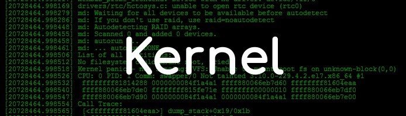
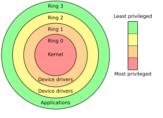

# Kernel-level anti-cheat system

 

 Los anticheats son softwares de seguridad que tienen como funcionalidad detectar modificaciones de sus programas que puedan ejecutar cambios en los ficheros. Tienen acceso a recursos ilimitados dentro del equipo y siguen un modelo de 3 componentes. 

 Surgieron porque los antivirus se ejecutaban en modo de usuario, por lo que los cheaters empezaron a hacer los exploits en modo Kernel. Cuando hicieron los anticheats en el kernel, intentaron hacer los exploits en modo de virtualización para no tocar el sistema operativo, pero crearon detecciones de las virtualizaciones. 

 Después de esta implementación, lo que hicieron los cheaters fue implementarlos mediante PCIe, que a día de hoy sigue investigándose. 

 

# Protection ring

 

 Los anticheats funcionan en distintos "Círculos" que van de más privilegios a menos privilegios, que se representan como anillos, y funcionan como un flujo de componentes: 

 

 

 Kernel driver: Se ejecuta como el primer componente del flujo dentro del Ring 0 (privilegios de kernel elevados), encargándose de registrar e interceptar system calls, escanear la memoria y reforzar la protección del kernel. 

 Servicio del modo usuario: Se ejecuta como un servicio de Windows, usualmente con permisos de SYSTEM. Se comunica con los drivers del kernel gracias a los IOCTLs. También revisa conexiones con los servidores, maneja los baneos, además de recopilar y transmitir telemetría (se ejecuta en Ring 3). 

 Game Injected DLL: Se inyecta o carga en los procesos de los juegos. Revisa los checks por parte del modo usuario, se comunica con el servicio y sirve como endpoint para proteger los procesos de los juegos (se ejecuta en Ring 3). 

 

# BattlEye anti-cheat system

 

Battle Eye tiene 3 procesos, 2 en Ring 3 y 1 en Ring 0.

El proceso en Ring 0 se llama BEDaisy.exe. Este driver de kernel registra las creaciones de procesos, la creación de hilos y los manejos de operaciones de objetos. Para comunicarse con los componentes de ring 3, usa un IOCTL. Entrando a los procesos de Ring 3, el primero que funciona es BEService.exe. Este servicio se comunica por la red con los servidores de Battle Eye, recibe los resultados de los drivers y realiza los baneos (expulsar del servidor). Después, para comunicarse con el DLL, usa una Named Pipe (tuberia con codigo). El DLL se carga como un proceso al iniciar el juego. Es el responsable de que el Usermode sea legitimo dentro del contexto de los procesos del juego, y en caso de que no sean íntegros, se encarga de terminar la conexión con el servidor

 

# Anti-cheat system on Linux

 

Los anticheats en Linux no funcionan por 2 grandes razones. La primera es que estos anticheats están hechos para leer kernel de Windows y no de Linux, a nivel de usermode funciona correctamente, pero el kernel de Linux es distinto al de Windows por eso no puede leerlo. Y, en caso de que hicieran un anticheat que funcionase en el kernel de Linux, dicho kernel es totalmente personalizable y por eso los desarrolladores de anticheats no se molestan en hacerlos para Linux, sin embargo, hay algunos anticheats como Battle Eye que tienen soporte para Linux que corren en Wine.
 

 

# Conclusions

 

Comprendiendo el funcionamiento de los anticheats, como verifican los archivos y como se comunican entre los distintos componentes, el acceso a nivel de kernel de los anti-cheats puede ser un riesgo enorme de filtración de los datos de los sistemas.

 

# References

 

https://s4dbrd.github.io/posts/how-kernel-anti-cheats-work/ 

 

# Authors & Contributors

 

Izan Villalba Corzo - https://github.com/izillanv

Paul Alejandro Tamayo Mestanza - https://github.com/tamayonesa

Wuke Zhang - https://github.com/oOmyLoveOo
